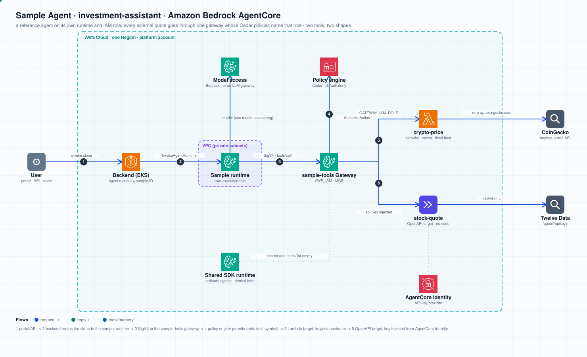
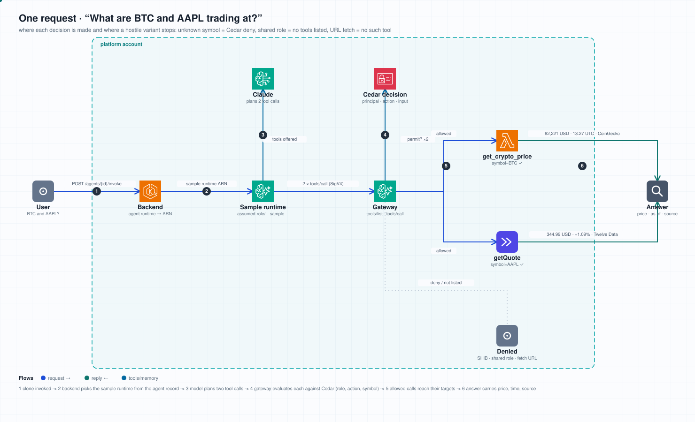

# Investment assistant: the design, decision by decision

The sample answers "what are BTC and AAPL trading at" with a quote that carries
its own timestamp and source. That is the whole function. What the sample is
for is everything around that function: how an agent reaches external data
without holding a key, without an open internet connection, and without the
platform having to trust its prompt.

Each section below is one decision, in four parts: what was done, what it
prevents, what skipping it would cost, and what to change when the sample
becomes your own agent against your own systems.

The customer conversation that produced this sample started from a working
agent whose runtime had internet access and fetched a price URL itself. It
worked. It also meant the price source's credential sat in the agent's
environment, the model could be talked into fetching any URL, and nothing on
the platform could say which hosts an agent had reached. Every decision here
is a reply to one of those three facts.

---

## 1. The runtime does not reach the internet; tools do

**Done.** The agent runs on an AgentCore Runtime in private subnets. It calls
tools through one AgentCore Gateway (SigV4, the runtime's own role) and the
gateway's targets are what reach upstream APIs: a Lambda for the crypto price,
the gateway itself for the stock quote.

**Prevents.** Server-side request forgery and exfiltration through the model.
An agent that can `fetch(url)` can be asked to fetch an internal metadata
endpoint, or to send what it knows to a host of the asker's choosing. An agent
whose only outbound path is a gateway with named tools can do neither: there
is no "fetch" tool, and the gateway's targets have fixed hosts.

**Skipping it costs.** Every prompt becomes part of the network boundary. You
would review prompt changes the way you review firewall rules, and a model
upgrade that changes how it handles instructions would be a security change.

**For your systems.** Keep the shape, change the targets. A private REST API
behind an internal ALB becomes an OpenAPI target with a private endpoint
(VPC Lattice); an internal service with no HTTP API becomes a Lambda target.
The agent's configuration does not change: it still has one MCP attachment,
the gateway.

## 2. One gateway with a policy engine, not one gateway per tool

**Done.** Both tools are targets on the same `sample-tools` gateway. A policy
engine is attached; Cedar policies decide, per call, whether this caller may
invoke this tool with these inputs.

**Prevents.** Two failure modes of the per-tool-gateway alternative. First,
drift: twenty tools become twenty gateways, twenty execution roles and twenty
places to audit. Second, false comfort: IAM's `InvokeGateway` is granted per
gateway and has no condition key for the tool name, so "one gateway per tool"
is the only way to make IAM alone decide tool access, and it does not scale.
The gateway's design point is the opposite: up to 100 targets per gateway,
with AgentCore Policy deciding at tool granularity. `tools/list` returns only
what the caller is permitted, so a caller does not even see tools it may not
use.

**Skipping it costs.** Either the sprawl above, or a single gateway where every
caller sees every tool and the agent's prompt is the only thing between a
read-only assistant and a tool that can act.

**For your systems.** Add tools as targets on the same gateway. Add a
`permit` per (caller role, tool) in the engine. Start the engine in
`LOG_ONLY`, read the decision traces for a week, then switch to `ENFORCE`. The
sample ships in `LOG_ONLY` for exactly that reason.

## 3. Each sample runs on its own runtime under its own IAM role

**Done.** `investment-assistant` has a runtime of its own, running the same
headless kernel image as every published agent, with an execution role of its
own. The Cedar policies name that role (`AgentCore::IamEntity`, the caller's
assumed-role ARN). The shared kernel role is in no sample policy.

**Prevents.** Identity confusion at the gateway. A Cedar policy can only be as
precise as the principal it sees, and with an IAM-authenticated gateway the
principal is the role. If every agent ran under one role, a policy permitting
"the investment assistant" would permit every agent on the platform.

**Skipping it costs.** The gateway could still restrict tools per role, but
"per role" would mean "per platform", and a tool attached to the investment
assistant would be callable by any agent a user publishes.

**For your systems.** One runtime per trust boundary, not per agent. Agents
that may call the same tools share a runtime and a role; an agent that may
call a tool with side effects gets its own. The runtime is cheap (no idle
cost); the role is the unit of policy.

## 4. Tool access is decided by the gateway, not by the agent's configuration

**Done.** An agent cloned from the sample records `runtime = sample:<id>`. The
backend admits that field only on a clone of that sample and keeps it on every
republish; a plain publish naming a sample runtime is refused. The user may
change the prompt, model, turn budget, skills and memory of a clone; the
runtime, and so the set of tools the gateway will allow, is not theirs to
change.

**Prevents.** The "I just attached the gateway" path. Without this, a user
could attach `sample-tools` to any agent; it would see no tools (policy), but
the failure would be confusing, and a future policy edit could open it. With
this, attaching the gateway to an ordinary agent is visibly inert, and the
only way onto a sample's identity is through the sample.

**Skipping it costs.** Tool access would depend on two things staying in sync,
the gateway's policy and the portal's attachment rules, and the portal's rules
are the ones users touch daily.

**For your systems.** Treat "which runtime" as a property set by whoever owns
the tool boundary (an administrator, a template, a pipeline), not by the
agent's author. The agent's author owns the prompt.

## 5. Two tools, two shapes, on purpose

**Done.** `crypto-price` is a Lambda target with code; `stock-quote` is an
OpenAPI target with no code at all.

| | crypto-price (Lambda) | stock-quote (OpenAPI) |
|---|---|---|
| upstream | CoinGecko public API, keyless | Twelve Data `/quote`, keyed |
| why this shape | the input needs validating, the result caching and normalising | the API is clean; only the key needs keeping out of the agent |
| credential | none; the function's role has logs only | API key in AgentCore Identity, appended by the gateway as `?apikey=` |
| what the agent sees | `crypto-price___get_crypto_price` | `stock-quote___getQuote` |

**Prevents.** Choosing one shape for everything. A Lambda for a clean REST API
is code to maintain for no reason; an OpenAPI target for a rough public API
leaves input validation and rate limiting to the model.

**Skipping it costs.** Nothing immediate; the cost is the wrong default for the
next twenty tools.

**For your systems.** Ask two questions per upstream: does the input need
validating or the output reshaping (Lambda), and does the API need a
credential the agent must not hold (OpenAPI target with a credential
provider, or a Lambda whose role reads a secret the agent cannot).

## 6. Where the credential lives

**Done.** The Twelve Data key lives in an AgentCore Identity API-key
credential provider that an operator registers with one command
(`scripts/set_sample_tool_key.sh stock-quote`, key from a file or stdin). The
foundation finds the provider by its conventional name
(`<env>sample-tool-stock-quote`) at plan time and publishes its ARN in the
facts; no tfvars carries it. The gateway's execution role may read that
provider's key (and no other); the gateway injects it on each outbound call.
The key is not in the agent, the Lambda, the repository, the Terraform state
or the backend. Without a provider, the OpenAPI target is not deployed and
the agent is told stock quotes are unavailable; rotating the key is the same
command and needs no apply.

Three places a key can live, compared:

| the key is in | leaks to | rotate by |
|---|---|---|
| the agent's environment or prompt | anyone who can read the runtime's environment or talk the model into printing it | redeploying the agent |
| a secret the Lambda's role reads | anyone who can invoke the Lambda with their own event, if the function echoes it | updating the secret |
| an AgentCore Identity provider the gateway reads | the gateway's execution role only; the Lambda, runtime and agent never see it | updating the provider |

**Prevents.** The original incident: a credential in an agent's environment,
one prompt injection away from disclosure.

**Skipping it costs.** A key rotation becomes an agent redeploy, and every
clone of the sample carries a copy.

**For your systems.** API-key and OAuth providers cover most upstreams. For an
upstream behind AWS IAM (API Gateway, Lambda URL, another AgentCore Gateway)
the gateway can sign with its own role instead.

## 7. Input constraints are written in Cedar, not only in code

**Done.** `crypto-price` accepts ten symbols. The allowlist is in the Lambda,
and it is also in the Cedar policy: `context.input.symbol` must be in the set
or the gateway denies the call before the function runs. `stock-quote` requires
a symbol; the upstream validates the ticker.

**Prevents.** Two things. The function being reached with an input it should
not see (defence in depth), and the constraint being invisible: a Cedar deny
is a decision in the audit trail with the principal, the action and the
input; a Lambda returning `unsupported_symbol` is a log line.

**Skipping it costs.** Changing the allowed set is a deployment instead of a
policy update, and the only record that a symbol was refused is in the
function's logs.

**For your systems.** Put the constraints a security reviewer would ask about
in Cedar (amount ceilings, allowed regions, read-only operations) and keep
business validation in code.

## 8. The answer carries its time and its source; the agent gives no advice

**Done.** Both tools return the upstream's own timestamp and a source string.
The prompt requires every quote to state price, currency, as-of time and
source, forbids estimating, converting or recalling prices, and forbids
investment advice. The eval set includes an advice request, an injection that
asks the agent to fetch a URL, and an unsupported symbol.

**Prevents.** A confidently stale or invented number. A market quote without a
time is wrong by definition a minute later; a quote without a source cannot be
checked.

**Skipping it costs.** The sample would demonstrate the mechanics and teach the
wrong habit.

**For your systems.** Make the tool return the provenance (time, source,
version) and make the prompt require it in the answer. Put the refusals you
need in the evals, so a prompt edit that drops one is caught.

## 9. What a clone keeps and what it may change

**Done.** A clone keeps the runtime (identity), the MCP attachment (the gateway)
and so the tool boundary. The user may change the system prompt, model, turn
budget, skills and memory.

**Prevents.** Treating the sample as a template that is copied and forgotten.
A clone is still bound to the sample's identity, so a policy change on the
gateway applies to every clone at once.

**Skipping it costs.** Twenty clones with twenty slightly different ideas of
what the agent may do.

**For your systems.** Decide which fields are the platform's and which are the
author's before you let anyone clone. Here the line is: anything that changes
*what the agent can reach* is the platform's; anything that changes *how it
talks* is the author's.

## 10. What this sample does not do

- **The runtime's security group still allows all egress.** The tool layer is
  the egress choke point, the runtime layer is not yet. Closing it needs an
  inventory of every endpoint the kernel reaches (model, S3, logs, the
  gateway) and VPC endpoints for each; that is the next step, not this one.
- **Demonstration data sources.** CoinGecko's keyless tier is rate-limited and
  not for production; Twelve Data's free plan is 8 calls per minute. A real
  deployment swaps the upstream in the tool package and leaves the agent alone.
- **One identity per sample, not per user.** The gateway sees the runtime's
  role, not the person who asked. If different users of the same agent should
  have different tool access, the gateway needs a JWT authorizer and policies
  over OAuth claims.
- **Policy in LOG_ONLY.** The engine records every decision and enforces none
  until the traces have been read for a week. Switching to ENFORCE is a
  one-line change in the foundation's variables.

## Where things are

| what | where |
|---|---|
| the agent (prompt, manifest, evals, README) | `samples/agents/investment-assistant/` |
| the Lambda tool (code, schema, Cedar template, tests) | `samples/tools/crypto-price/` |
| the OpenAPI tool (spec, Cedar template, tests) | `samples/tools/stock-quote/` |
| the gateway, policy engine, roles (foundation) | `agent-platform-ops`, `terraform/modules/sample_tools`, `modules/runtime` |
| the targets, policies, Lambda, sample runtime (workloads) | `terraform/workloads/modules/sample_tools`, `modules/runtime` |
| the clone, status, try and seed | `backend/app/services/samples_service.py`, `backend/app/api/samples.py` |
| the runtime binding and its tests | `backend/app/services/agent_service.py`, `backend/tests/test_sample_runtime_binding_adversarial.py` |
| the rendered-policy test | `scripts/tests/test_sample_policies_adversarial.py` |
